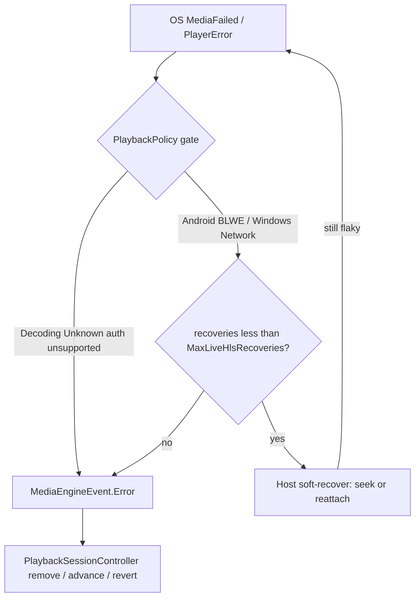

# Stream Playback Rules

**STATUS:** Android, Windows, Linux, and Apple hosts execute `PlaybackSessionController` effects through `DelegatingMediaEngine` (`IMediaEngine`). OS players attach/stop/raise facts only.  
**AUDIENCE:** Developers and AI assistants working on MAUI stream handling (Android, Android TV, Windows, Linux/WSL)  
**RELATED:** [STREAM_HEALTH_PROTOCOL.md](STREAM_HEALTH_PROTOCOL.md)

### Implementation

| Type | Path | Role |
|------|------|------|
| `PlaybackPolicy` | `VardyParty.Playback/Domain/PlaybackPolicy.cs` | Pure rules (attach, navigate, revert, cache retry, decline) |
| `PlaybackSessionController` | `VardyParty.Playback/Domain/PlaybackSessionController.cs` | State machine: engine events → effects |
| `PlaybackCommand` | `VardyParty.Playback/Domain/PlaybackCommand.cs` | Collapses effect batches (remove+advance must not skip) |
| `IMediaEngine` | `VardyParty.Playback/Application/IMediaEngine.cs` | Slim OS contract (Attach/Stop/events/metrics only) |
| `DelegatingMediaEngine` | `VardyParty.Playback/Infrastructure/DelegatingMediaEngine.cs` | Host adapter: OS plugs attach/stop/metrics, raises facts |
| Effects / events | `PlaybackEffect.cs`, `MediaEngineEvent.cs` | Host executes effects; engine emits facts |
| `PlaybackCommandExecutor` | `VardyParty.Playback/Domain/PlaybackCommandExecutor.cs` | Interprets flags; every OS host uses this |
| `PlaybackPoolCommandActions` | `VardyParty.Playback/Domain/PlaybackPoolCommandActions.cs` | Pool clear/remove/retry/attach-current for **every** host; fresh URL accept uses `PlaybackPolicy.ShouldAcceptFreshM3U8` against session current URL |
| Android host | `Platforms/Android/NativeVideoActivity.Playback.cs` | ExoPlayer facts → same loop; pool via `PlaybackPoolCommandActions` |
| Windows host | `Platforms/Windows/WindowsVideoPlayerService.Playback.cs` | WinUI facts → same loop; pool via `PlaybackPoolCommandActions` |
| Linux host | `VardyParty.Linux/Services/LinuxVideoPlayerService.cs` | LibVLC facts → same loop; software-frame compositing into Avalonia Image so chrome overlays video; standalone libvlc window fallback |
| iOS host | `Platforms/iOS/IOSVideoPlayerService.cs` | AVPlayer asset; session/executor/pool in `AppleVideoPlayerServiceBase` (`#if IOS \|\| MACCATALYST`, namespace `VardyParty`) |
| MacCatalyst host | `Platforms/MacCatalyst/MacCatalystVideoPlayerService.cs` | AVPlayer asset; same shared Apple base |
| Tests | `tests/VardyParty.Playback.Tests/Playback*.cs`, `FakeMediaEnginePlaybackTests.cs`, `StreamMetricsWindowTests.cs`, `DelegatingMediaEngineTests.cs`; orchestrator cache retry in `tests/VardyParty.Streaming.Tests/StreamResolutionOrchestratorTests.cs`; health identity/reporter in `tests/VardyParty.Streaming.Tests/` | Policy + session + command collapse + fake `IMediaEngine` host loop + orchestrator cache retry |

---

## Testing seam (OS vs Core)

Business recovery must stay under unit tests. OS decoder/chrome differences are large (ExoPlayer vs WinUI AdaptiveMediaSource, TV remote, request headers, Activity vs MediaPlayer). Those do **not** belong in domain unit-test projects.

**Do test via a common interface:**

```
ExoPlayer / WinUI / FakeMediaEngine  →  IMediaEngine (facts only)
                                         ↓
                              PlaybackSessionController
                                         ↓
                         host executes PlaybackCommand (pool, resolve, health)
```

`FakeMediaEnginePlaybackTests` is the OS-shaped business test: a fake engine implements `IMediaEngine`, a tiny host interprets `PlaybackCommand` the same way Android, Windows, Linux, and Apple do.

**Do not share one fat player interface** (`INativeVideoPlayerService` stays a launch/chrome contract: `PlayVideoAsync`, overlay, referer). Collapse OS recovery into `IMediaEngine` + session, not into a second policy class per platform.

Health reports key on the catalog/page URL via `StreamHealthIdentity.ResolveReportUrl` (ephemeral `.m3u8`/`.mpd` URLs are not the crowd identity). Cache→fresh retry is covered by `StreamResolutionOrchestratorTests`. The old Blazor `/player` single-URL path (`VideoPlayer.razor`) was deleted with the WebView UI.

---

## Goal

One set of business rules for stream **selection → start → survive → switch → recover**.  
OS code should only attach/detach media and surface metrics/errors. Shared domain owns decisions.

Today: selection/pre-play is shared; **runtime recovery is Playback** (`PlaybackSessionController`) on Android, Windows, Linux, and Apple. Hosts only attach/stop and raise engine facts.

---

## As-is architecture

```
HomeHostPage / LinuxHomePage
  └─ StreamResolutionOrchestrator          ← shared select / start / post-PlayVideoAsync failure
       ├─ StreamSelectionCoordinator
       ├─ StreamResolver + StreamHealthChecker
       ├─ StreamSwitchingService            ← healthy pool + index Rx
            └─ INativeVideoPlayerService.PlayVideoAsync(...)
                 ├─ Android (+ TV): NativeVideoActivity + DelegatingMediaEngine (ExoPlayer)
                 ├─ Windows: WindowsVideoPlayerService + DelegatingMediaEngine (WinUI)
                 ├─ Linux/WSL: LinuxVideoPlayerService + DelegatingMediaEngine (LibVLC window)
                 ├─ iOS: Platforms/iOS + AppleVideoPlayerServiceBase (AVPlayer)
                 └─ MacCatalyst: Platforms/MacCatalyst + AppleVideoPlayerServiceBase (AVPlayer)
                      all: engine facts → PlaybackSessionController → PlaybackCommandExecutor
                           pool/retry: PlaybackPoolCommandActions in VardyParty.Playback
```

Android phone and Android TV share the same ExoPlayer activity; TV differs mainly in remote/overlay focus (`MauiProgram.IsTv`, `RemoteKeyHandler`).

---

## Phase matrix

| Phase | Shared Core | Android / Windows / Linux | Notes |
|-------|-------------|---------------------------|-------|
| **Select / order** | Recommendations + catalog order + FB-before-MP | Uses Core | Keep in Core |
| **Pre-play probe** | `StreamHealthChecker` | Uses Core | Keep in Core |
| **Skip countdown** | `StreamResolver` skips `IsCountdown` | — | Keep |
| **Start first healthy** | First healthy → `PlayVideoAsync`; continue testing | Attaches ExoPlayer / AdaptiveMediaSource / LibVLC | Keep |
| **Cache → fresh retry** | Once if cached M3U8 fails (CDN token) | Hosts attach whatever URL Core gives | Covered by `StreamResolutionOrchestratorTests` |
| **Prefetch next M3U8** | `PrefetchUpcomingStreamUrl` | Index change rebinds | Keep |
| **User Next / Prev** | Session `UserNext` / `UserPrevious` | Rebind URL; **must not** mark bad | Shared policy |
| **Hard playback error** | Session `Error` → remove + advance or revert | `engine.Raise(Error)` | One policy |
| **Soft live-HLS recover** | `PlaybackPolicy.MaxLiveHlsRecoveries` (+ BLWE / network gates) | Android: seek-to-live on BLWE; Windows: AdaptiveMediaSource reattach on **NetworkError only**; Linux: `--http-reconnect` (no budget) | Host-local; no session Error until budget exhausted |
| **Soft decline (buffer/bitrate)** | `StreamMetricsWindow` via session Metrics/Buffering | Android 30s metrics; Windows throttled PositionChanged; Linux 30s timer | Shared window |
| **Brief rebuffer tolerance** | `DesiredLiveOffsetSeconds` + Android LoadControl ms constants | Windows DesiredLiveOffset; Android DefaultLoadControl; Linux `--network-caching` | Named in `PlaybackPolicy` |
| **Failed switch** | Retry the target within the same-stream budget, then restore last-good; only a confirmed-dead target is reported and removed | Hosts execute `PlaybackCommand` (revert also puts the pool index back on last-good) | Locked by `PlaybackUnificationRulesTests`, `FailedSwitchRecoveryBusinessRulesTests` |
| **Failed start (never established)** | Remove + advance if pool remains | Hosts execute `PlaybackCommand` | Shared |
| **Stale failure during switch** | Ignore if `generation != AttachGeneration` | Hosts compare session generation | Shared |
| **Buffering → Core** | Session Buffering effect | All three raise `MediaEngineEvent.Buffering` | Always raise |
| **Health reports** | `StreamHealthIdentity.ResolveReportUrl` (page over M3U8) | Android still passes M3U8+referer; reporter prefers page | Single identity |

---

## Detailed as-is rules

### 1. Selection & pre-play (Core — keep)

1. Build candidate queue (`StreamSelectionCoordinator`); apply crowd recommendations when confidence is high/medium.
2. Expand V2 / order catalog sources; prefer FB-before-MP where applicable.
3. Skip streams with countdown active on the page.
4. Resolve M3U8 via LAN play service / API; probe with `StreamHealthChecker`.
5. Probe outcomes: `Healthy` | `ManifestUnreachable` | `InvalidManifest` | `EmptyManifest` | `SegmentUnreachable`.
6. Deduplicate healthy URLs in the switching pool.
7. Play the **first** healthy stream immediately; keep resolving others in the background.

### 2. Start & cache retry (Core — keep)

1. Prefer `ResolvedM3U8Url` from probe/prefetch.
2. If playback fails and a cached URL was used (and user did not close), resolve fresh once; retry only if the fresh URL differs.
3. Prefetch the upcoming candidate’s M3U8 while current plays.

### 3. Switch eligibility (partially shared)

Shared helper `SwitchingDecision.CanSwitch(currentUrl, candidateUrl, isPreparing)`:

- Reject empty candidate
- Reject while preparing
- Reject same URL (case-insensitive)

Android duplicates this in `NativeVideoActivity.CanSwitchTo`. Windows uses local guards (`suppressIndexDrivenSwitch`, same URL, generation). **Target:** all platforms call `SwitchingDecision` (or successor).

### 4. Android recovery (`NativeVideoActivity`)

ExoPlayer facts go through `DelegatingMediaEngine` → `PlaybackSessionController`. The activity executes `PlaybackCommand` (pool remove, attach, buffering report). Null `OnPlayerErrorChanged` is ignored (`ShouldIgnoreClearedEngineError`). Playback ended does not auto-next.

**Soft live-HLS recover (host-local, before Error):** On `BehindLiveWindow` (`PlaybackPolicy.IsBehindLiveWindowFailure` / Media3 error code 1002), the host seeks to the live edge and `Prepare`s without raising `MediaEngineEvent.Error`. Attempts are capped by `PlaybackPolicy.MaxLiveHlsRecoveries` (shared with Windows). Budget resets on intentional attach generation change and on `STATE_READY`. After the budget is exhausted, the host escalates via `MediaEngineEvent.Error` → pool remove / advance (same session path as any hard failure).

**Brief rebuffer tolerance:** `DefaultLoadControl` buffer durations come from `PlaybackPolicy` (`AndroidMinBufferMs` / `AndroidMaxBufferMs` / `AndroidBufferForPlaybackMs` / `AndroidBufferForPlaybackAfterRebufferMs`), paired with Windows `DesiredLiveOffsetSeconds` and Linux `--network-caching`.

### 5. Windows recovery (`WindowsVideoPlayerService`)

WinUI `MediaFailed` / download failures / buffering raise engine facts. Stale work is ignored when `generation != session.AttachGeneration`. Consecutive AdaptiveMediaSource download failures call `NotifyDownloadFailure` (threshold in Core). Successful downloads call `NotifyDownloadSuccess`.

**Soft live-HLS recover (host-local, before Error):** WinUI has no BehindLiveWindow API. For **network-class** `MediaFailed` only (`PlaybackPolicy.IsRecoverableLiveHlsMediaFailure` — Decoding / Unknown / unsupported / aborted / auth escalate immediately), the host rebuilds `AdaptiveMediaSource` for the same URL via `StartPlaybackAsync` **without** `BeginAttach` (session generation and pool entry stay). Attempts are capped by `PlaybackPolicy.MaxLiveHlsRecoveries`. The counter resets only on intentional `AttachViaSession` (switch/start) — soft-reattach Ready does **not** zero it (Ready fires as soon as the item is assigned). Nested `MediaFailed` while a soft-reattach is in flight is coalesced (in-flight guard). After the budget is exhausted, escalate with `MediaEngineEvent.Error` → pool remove / advance.

**Live edge backoff:** `AdaptiveMediaSource.DesiredLiveOffset` uses `PlaybackPolicy.DesiredLiveOffsetSeconds`.

Linux LibVLC uses `--http-reconnect` instead of this shared soft-recover budget; classification and Error escalation for hard failures still go through the same session controller.



**Decline window** (`StreamMetricsWindow`, 60s buffering/bitrate window; errors over 300s):

- ≥ 4 buffering events → declined  
- ≥ 3 bitrate samples with average &lt; 300 kbps → declined  
- ≥ 10 bitrate samples and last 3 all &lt; 500 kbps → declined  
- ≥ 3 errors in 300s → declined  

`AndroidVideoPlayerService.ReportBufferingState` now forwards to `BufferingStateChanged`. Soft decline is a session effect (remove + advance). The orchestrator's playback chain (`RunPlaybackChainAsync`, section 6) handles a `PlayVideoAsync` that returns failure - native auto-switch may already have drained the pool (the chain then waits for the next healthy row).

### 6. Orchestrator start failure: the playback chain (Streaming)

The first healthy row to clear the catalog frontier starts `RunPlaybackChainAsync` **while candidate testing continues**. When a play returns `Success == false` (not viewer-left):

1. Local service unavailable (no verdict): no report, nothing removed; the chain parks and the next row to join the pool starts playback.
2. Otherwise report health `failed` once for the row that failed (the row tried if the player never opened, else the pool's current row) and remove it.
3. Play the row now under the pool index (the merged fallback or the following row). The old `TryNextHealthyStreamAsync` called `GetNextHealthyStream` here, skipped a row, left the index on a row that was not playing, and dropped the next play's result.
4. Pool empty: status "All available streams failed - testing others..."; the next healthy row added by enumeration starts the chain again. After the sweep a failed chain resumes selection testing.

**Why (31 Oct 2026):** a first `/play` that came back empty ("Failed to resolve m3u8") used to be handled only after the whole sweep and the deferred re-queues (5s + 15s) finished, so the "Finding streams... 2 healthy" dialog sat with healthy rows unplayed. Rules: `StalledFirstPlayBusinessRulesTests`.

### 7. Health reporting identity

Protocol keys on `streamUrl` ([STREAM_HEALTH_PROTOCOL.md](STREAM_HEALTH_PROTOCOL.md)). `StreamHealthIdentity.ResolveReportUrl` prefers the catalog/page URL (referer) when the first argument is an ephemeral M3U8/DASH URL. Android still passes M3U8 + referer; the reporter stores the page URL.

Native players report through `StreamHealthIdentity.ResolvePlaybackReportIdentity(current, playbackUrl, referer)`: the current pool entry's catalog URL and stream name win over the m3u8 and the embed referer, so the orchestrator and the player use one key. `StreamHealthReporter` drops a duplicate of the same status for the same key inside 20s (`working`, `buffering`, and the `started` report under its own key) and a duplicate `failed` inside 60s. `user-report` is never suppressed. The orchestrator's 30s health tick reports `streamSwitchingService.GetCurrentStream()`, not the stream playback started on.

---

## Unified policy (in Core)

`PlaybackPolicy` + `PlaybackSessionController` own these rules. Platforms only emit facts.

### States

`Idle → Probing → Starting → Playing → Buffering → Declining → Switching → Recovered | Failed | Closed`

### Rules (normative)

1. **Next/Prev never marks a stream bad** — only explicit user report or policy-classified hard fail / decline.
2. **Established playback** = first successful decode/ready (Android `STATE_READY` + tracks; Windows source attach + playback). Track `lastGoodUrl` + `generation`.
3. **Hard fail** (decoder/source error, or ≥ N consecutive download failures):  
   - Clear `ResolvedM3U8Url` for current  
   - Remove from healthy pool  
   - If another healthy exists → switch to next (resolve/prefetch)  
   - Else → resume probing / fail session  
   - Do **not** silently revert unless switch itself failed after leaving last-good (see 4).
4. **Failed switch** (new URL never established): retry the target with the same-stream budget, then restore `lastGoodUrl`. The target is kept and not reported unless the error is `ConfirmedDead` (see "Failed switch: retry the target, keep it").
5. **Soft decline** (shared `StreamMetricsWindow` thresholds on all platforms): same as hard fail for pool removal + advance (tunable; start by matching Android numbers).
6. **Cache retry**: one fresh resolve if first attach used cache and failed before established.
7. **Stale events**: ignore errors whose `generation != currentAttachGeneration`.
8. **Single health reporter**: platforms push metrics/errors into Core; Core posts to API with one identity key.
9. **Buffering always raises** `BufferingStateChanged` into Core on every OS.
10. **Retry the same stream before switching** (supersedes the "remove + advance" in rules 3 and 5 for a stream that has played). See [Same-stream recovery](#same-stream-recovery-and-infrastructure-failures-31-oct-2026).
11. **An infrastructure failure is never a stream failure.** No endpoint, our own `/play` timeout, or a refused connection never marks a row Failed and never reports it. The row is `Deferred` and re-queued.
12. **Report once.** `ReportFailed` / `ReportDeclined` run before the pool is cleared, so the report carries the stream that failed; the reporter drops duplicates.

### Slim OS adapter surface (target)

```text
Attach(url, headers) / Stop()
Observe → Ready | Buffering | Metrics | Error(code, message) | Ended
Optional: native chrome / TV remote wiring only
```

No switch, recover, overlay stream list, or health POST logic inside platform files.

---

## Observability — AI / human “is this stream healthy?”

### Android TV / Android phone — live logs

Correct one-shot filter by process (avoid duplicating `adb logcat`):

```bash
adb logcat --pid=$(adb shell pidof -s com.vardyparty)
```

**PowerShell** (Windows host talking to device/emulator):

```powershell
$pid = adb shell pidof -s com.vardyparty
adb logcat --pid=$pid
```

Useful filters once you have the PID stream:

```bash
adb logcat --pid=$(adb shell pidof -s com.vardyparty) | rg "StreamResolution|StreamSelection|StreamHealth|NativeVideoActivity|Playback error|Switch|declin|buffer"
```

Optional tag focus:

```bash
adb logcat VardyParty:I NativeVideoActivity:I *:S
```

### Log markers to treat as a session timeline

| Marker | Meaning |
|--------|---------|
| `[StreamResolution]` | Orchestrator select/start/switch/prefetch/cache-retry |
| `[StreamSelection]` | Candidate queue / pause-resume testing |
| `[StreamHealth]` / health reporter | Crowd reports |
| `[NativeVideoActivity] Player ready` | Established on Android |
| `[NativeVideoActivity] Playback error` | Hard fail → auto-next |
| `[NativeVideoActivity] Switching player` | Rebind after index change |
| Windows `VideoPlayer` / `WindowsEventLogger` | Attach, MediaFailed, revert, generation ignore |
| `Stream failed after 5 consecutive download errors` | Windows soft→hard path |

### Healthy session (expected pattern)

1. Probe → Healthy  
2. Using cached or fresh M3U8  
3. Player ready / source attached  
4. Playback started (+ metadata)  
5. Periodic metrics without rapid error/auto-switch  

### Unhealthy session (expected pattern)

1. Ready never reached, or  
2. Playback error / MediaFailed / max download failures, then  
3. Switch / remove / revert (platform-dependent until unified), then  
4. Either Recovered (ready again) or pool exhausted  

### Target for AI agents

Emit one structured event stream (file or log JSON lines) per session:

`ProbeResult` → `PlaybackEstablished` → `MetricsSample` → `BufferingSpike` | `Declined` | `HardFail` → `SwitchRequested` → `SwitchSucceeded` | `Reverted` → `SessionEnded`

Until that exists, agents should reconstruct the timeline from the markers above. Failed-switch revert vs advance is no longer a platform fork — Core reverts (locked by `PlaybackUnificationRulesTests`).

---

## Segment payloads (image-wrapped MPEG-TS)

Some providers (cowedd `premium1`, castppv/uzhi.ru) serve HLS media segments from
TikTok image CDNs (`*.tiktokcdn*.com/...~tplv-...image`, `Content-Type: image/png`).
Many of these are **not** decoys: the PNG (8-bit RGB, IHDR/IDAT/IEND only) carries
pixels `TIKTIKPX` + uint32 BE length + a gzip member whose output is MPEG-TS.
A second wrapper (castppv / uzhi.ru `tntsports1-uk`, `Content-Type: image/webp`) is a
RIFF/WebP with a 1x1 `VP8L` image chunk followed by an `EXIF` chunk whose payload is
raw MPEG-TS (`WebpWrappedTs.cs`).

Rules (normative; tests in `SegmentPlayabilityBusinessRulesTests`):

1. **Bytes decide, not URL or Content-Type.** `SegmentPayload.Classify` (first 64 KB)
   returns `MpegTs`, `Fmp4`, `WrappedTs`, `Image`, `Text` or `Unknown`; only
   `MpegTs`/`Fmp4`/`WrappedTs` are playable.
2. **Wrapped TS is playable on every platform.** One shared decoder
   (`VardyParty.Streaming/Domain/Media/PngWrappedTs.cs` + `WebpWrappedTs.cs`, via `SegmentPayload.TryUnwrap`; never throws, size-capped)
   is used by every player path:
   - Android: `UnwrappingDataSource` wraps the ExoPlayer/Media3 HLS DataSource
     (non-ranged opens; serves the unwrapped TS as `video/mp2t`).
   - Windows: `AdaptiveMediaSource.DownloadRequested` body for `MediaSegment`.
   - Linux: `LinuxHlsLocalProxy` segment branch before LibVLC.
   - iOS / Mac Catalyst: **not hooked** — AVPlayer fetches segments natively;
     needs a loopback proxy (as Linux) to unwrap.
3. **Plain images stay rejected.** PNG without the marker, WebP without a TS-carrying chunk, JPEG/GIF, marker
   without a TS payload, and HTML/JSON are never converted to video.
4. **Never trust soak without classification.** `StreamHealthChecker` falls back to
   a ranged (0-65535) byte probe *with* soak headers for image-looking segments;
   `ShouldSkipClientCdnProbe` alone never marks a stream Healthy.
5. LocalService `/play` (Strategies `HlsVideoDataProbe` / `PlayEngine`) applies the same
   byte rule via a copy of the decoder, so it keeps wrapped-TS playlists and still
   rejects plain-image ones.

## Healthy pool dedup (same m3u8 from several sites)

Many catalog sites embed the same upstream channel. The 27 Oct 2026 session showed
Liveverse, 1ststreams and Pitchstream all resolving to cowedd `premium38/index.m3u8?t=...`,
and soccermlbstream, All-Sports-HD and Vivoentv all resolving to uzhi.ru
`/main/secure/<64-hex>/<expiry>/skysportsfootball-uk.m3u8` - six "streams", two channels.

Rules (normative; tests in `HealthyPoolDedupBusinessRulesTests` and `StreamUrlNormalizerTests`):

1. **One visible entry per m3u8 identity.** `StreamSwitchingService.AddHealthyStream`
   keys on `StreamUrlNormalizer.M3u8IdentityKey(ResolvedM3U8Url)`: query/fragment stripped,
   scheme+host lowercased, and token-like *directory* segments dropped - pure digits (9+,
   expiry), hex (32+), mixed-case base64url (32+). Host and every other segment are kept and
   the final filename is never dropped, so `premium38` vs `premium35`, different channel
   filenames, and different hosts stay separate. The pool is what Android, Windows, Linux and
   Apple all render, so this is the single dedup point for every platform.
2. **Who stays visible.** First healthy (the flush is already catalog/ranked order) wins.
   A later duplicate replaces it only with a strictly higher `Reputation` *and* when the
   visible one is not the stream playing - never swap under the viewer.
3. **Merged duplicates are fallbacks.** Losers are kept hidden per key. When the visible
   entry fails (`RemoveCurrentStream`), the best-reputation fallback is promoted *at the same
   index* (index re-published, so hosts re-attach with a fresh `/play` for that source);
   only when a key has no fallbacks does the pool shrink.
4. **Identity is captured on add.** `ResolvedM3U8Url` is mutated later (fresh one-shot
   `/play`, cleared to null on failure); the key is stored when the stream enters the pool.
5. **No URL, no merge.** An empty key never matches, so unresolved entries are not collapsed.
6. Chip selection (`SwitchToMatchingStream`) naming a merged source selects its visible
   entry. It never reorders the pool (see "Stable channel numbering").

The old page-URL `StreamDeduplicator` (catalog `stream.Url` + V2 label) was never called in
production (only DI-registered) and was removed; dedup of catalog rows by page URL is not
done - distinct pages are resolved and merged here by what they actually play.

## Proven mirrors (31 Oct 2026)

Some providers serve one encoder output from several hosts, e.g. `edgestream2.pro/hls/syaLqucEne4k.m3u8`
and `edgestream5.pro/hls/syaLqucEne4k.m3u8`. Their identity keys differ (host is kept), so the rule
above shows both. They are merged only when the media proves it. Rules (normative; tests in
`MirrorProofPolicyTests`, `ProvenMirrorDedupBusinessRulesTests`, `StreamHealthCheckerMirrorEvidenceTests`):

1. **Evidence comes from the health check.** When a media (variant) playlist passes,
   `StreamHealthChecker` stores `StreamHealth.MirrorEvidence`: segment URIs, the segment name stem
   (trailing number replaced by `{n}`, e.g. `syaLqucEne4k-{n}.ts`), the live-edge segment number,
   whether those numbers are a 90 kHz PTS clock (consecutive numbers advance by EXTINF x 90000;
   needs 2+ segments, a plain counter is not a clock), `EXT-X-MEDIA-SEQUENCE`, live-edge
   `EXT-X-PROGRAM-DATE-TIME`, target duration and when it was read. A failed check stores none.
   It reaches the pool on `EnrichedStream.Health` (`StreamResolver` -> `StreamResolutionOrchestrator`
   -> `AddHealthyStream`).
2. **Proof** (`MirrorProofPolicy.Evaluate`, pure). Either
   (a) both names are a PTS clock with the same stem, and the live-edge numbers differ by the time
   between the two reads (33-bit wrap aware) within **+/-5 s**; or
   (b) live-edge PROGRAM-DATE-TIME agrees within **~2 s** after the same elapsed-time correction,
   with the same target duration and the same naming pattern (letter runs `a`, digit runs `9`).
   If (a) applies and is out of tolerance it is not proven; (b) is not tried.
3. **Never a reason:** host-name similarity, URL shape, or catalog labels. Missing or ambiguous
   evidence (no playlist evidence, single segment, counter names without PROGRAM-DATE-TIME) never merges.
4. **Different `premiumNNN` ids never merge** (any `premium<digits>` in the source, playlist or
   segment paths; present on one side only also counts as different), even when clocks agree:
   wedd48c premium109/155/261 stay three channels.
5. **Where:** `StreamSwitchingService.AddHealthyStream`, after the identity-key check (unchanged).
   A proven mirror merges into the visible entry exactly like a same-key duplicate: hidden fallback,
   no channel number, promoted in place when the visible entry fails, never swapped in under the
   viewer. Its own key is aliased to that entry, so later rows on the mirror URL merge without new
   evidence. Stable numbering rules are unchanged.
6. **Log:** `[Dedup] proven mirror: <incoming channel url> == <visible channel url> (pts delta -0.90s)`
   (or `pdt delta`). Rejections with evidence on both sides log at Debug as `[Dedup] not a proven mirror`.
7. The lshls `secure_hls.php?path=` identity handling is untouched.

Observed (v223, UTC): edgestream2 `-944307180.ts` at 20:21:45.362 and `-953640450.ts` at 20:23:31.002
(103.70 s of media in 105.64 s, -1.94 s); edgestream5 `-957960270.ts` at 20:24:17.960 (151.70 s in
152.60 s from the first read, -0.90 s).
## Stable channel numbering (31 Oct 2026)

A channel number is the row's position in `StreamSwitchingService.GetHealthyStreams()` plus one. Every platform renders that list, so the numbers are the same on Android, Windows, Linux and Apple. Rules (tests in `StableChannelNumberingBusinessRulesTests`):

1. **Numbers do not move while cycling.** Next, Previous, wraparound, chip selection and recommendations change only the current index, never the order. `ReorderHealthyStreams` was removed.
2. **New healthy streams are appended** and take the next number.
3. **A drop closes the gap.** Rows after it move up one and keep their relative order. A merged fallback promoted in place keeps the number.
4. **Merged duplicates never take a number** (hidden fallbacks, see "Healthy pool dedup").
5. **Wraparound:** Next on the last channel goes to channel 1; Previous on channel 1 goes to the last. Wraparound force-refreshes recommendations (chips and first pick) but does not jump to a "preferred recommended" stream and does not reorder. The old "switch to the preferred recommended stream on wraparound" behaviour was removed: it made Next land on an unexpected number.
6. **Recommendations may jump** (chip selection selects the matching row) but never reorder.
7. A switch that fails and reverts keeps the target in place (see "Failed switch: retry the target, keep it").

## Switch speed: reuse, pre-resolve, make-before-break

V1/FB rows carry soak evidence (Referer/Origin/Cookie headers or MP rewritten segments), so
`PlaybackUrlReusePolicy.RequiresFreshM3u8ForPlayback` is true and historically every attach
re-ran `/play` (~10-15 s on V1). Rules (Kernel `PlaybackUrlReusePolicy`, `M3u8TokenExpiry`):

1. **Token expiry is read from the URL** - cowedd `t=<unix>.<sig>`, generic `e`/`exp`/`expires`/`expiry`/`x-expires`
   (s or ms), a JWT `exp` in any query value (sporty-aoura `token=`), and the last 10-digit path segment
   before the file name (uzhi `/main/secure/<hex>/<unix>/x.m3u8`). Sources can add a parser with
   `M3u8TokenExpiry.Register` (runs first, exceptions ignored).
2. **Reuse** - a one-shot row whose cached URL has a readable expiry with **> 60 s** left
   (`MinComfortableLife`) and is not **known single-use** plays the cached URL straight away
   (`usedCachedUrl: true`, so a failed start still gets the session's one fresh `/play` retry).
3. **Known single-use** stays on the fresh path: Cookie-bound rows (FB), MP rewritten-segment rows,
   hosts registered with `PlaybackUrlReusePolicy.RegisterSingleUseHost`, and any URL with **no readable
   expiry** (unknown = single-use; keeps 5604455's tests).
4. **Pre-resolve** - `UpcomingStreamPrewarmer` runs for the whole playback session and keeps the next
   `PrewarmDepth` = 2 rows in switch order warm in `WarmPlaybackUrlCache` (never the current row). Single
   flight: at most one `/play` in flight from it; 15 s tick; refreshes 30 s before the comfort margin.
   Short-lived tokens (lifetime < 5 min, cowedd ~2 min) are kept warm only for the immediate next row.
   A URL with no readable expiry marks the row unwarmable (no retry loop).
5. **Switch uses the warm URL** - `PlaybackUrlResolver` (the platforms' fresh-resolve delegate) waits
   for an in-flight pre-resolve of the same row, then consumes the warm entry once (> 60 s left) instead
   of calling `/play`; otherwise `/play` as before.
6. **No redundant re-scrape (d)** - the orchestrator no longer fires a bare
   `ResolveM3U8ForPlaybackAsync` prefetch for one-shot rows on Next (Android ignored it, so every switch
   cost two `/play`s, the second for the following row) and no longer resolves an empty one-shot row
   before switching; it kicks the pre-resolver instead. A failed Android switch no longer calls
   `SwitchToPreviousStream` + re-attach (which re-`/play`ed the stream being left).
7. **Make-before-break** - `PlaybackPoolCommandActions.SwitchToCurrentAsync`: the playing stream keeps
   playing while the target resolves, with "Switching to X..." shown; on failure the pool index is put
   back on the playing row **without re-attaching it** and "Couldn't switch to X - staying on the current
   stream" is shown. A newer switch supersedes an older pending one.

Platform limits: every platform has one player instance, so the cut-over happens once the new URL is
resolved, not after its first segments are buffered (true pre-buffer needs a second ExoPlayer /
MediaPlayer / LibVLC instance and a surface swap). Status text: Android toast, Windows stream-count
line, Linux log only (no overlay).

Tests: `M3u8TokenExpiryTests`, `PlaybackUrlReusePolicyTests`, `StreamSwitchReuseBusinessRulesTests`
(Kernel); `WarmPlaybackUrlCacheTests`, `UpcomingStreamPrewarmerTests`, `SwitchPrewarmBusinessRulesTests`,
`StreamResolutionOrchestratorTests.Rule_NextOntoOneShotRow_DoesNotIssueBarePrefetchPlay` (Streaming);
`PlaybackUrlResolverWarmTests` (Hosting); `PlaybackSwitchMakeBeforeBreakTests` (Playback).

---

## Same-stream recovery and infrastructure failures (31 Oct 2026)

Found in the 31 Oct 2026 Android TV and local-service logs (UK time): a 16:35:57 cascade that dropped and reported reachable streams; a techydeals row whose `/play` was sent twice (16:49:54 and 16:50:14) because our 20s timeout fired while the service was still resolving, then failed at 16:50:34; re-discovery from 16:51:43 to 16:53:03 after the endpoint was thrown away; and the same `working` sample sent twice (16:49:27 and 16:49:29).

### Error classes (`PlaybackPolicy.ClassifyPlaybackError`)

| Class | Examples | First step |
|---|---|---|
| `ConfirmedDead` | DNS failure (`UnknownHostException`), connection refused, playlist 404/410, decoy or image segment, decoder init failure, "No m3u8 URL returned" | Report and switch now |
| `TokenOrPlaylistInvalid` | 401/403, `#EXTM3U` header missing, manifest parse error | Fresh `/play` for the same row |
| `Transient` | Anything else, including a bare "Source error", timeouts, segment 404 | Reload the same URL |

Hosts must put the error-code name and cause chain into the Error message (`PlaybackPolicy.BuildEngineErrorMessage`); Android "Source error" alone classifies as Transient.

### Same-stream retry budget (`PlaybackSessionController`)

- Up to `MaxSameStreamRetries` (3) attempts per stream: attempt 1 of a transient error reloads the same URL; later attempts, and any token/playlist error, request a fresh `/play` (`RetryFreshResolve`) with backoff 0s / 1s / 3s.
- No `ReportFailed`, no pool removal and no advance while attempts remain. The snapshot shows `IsRecovering` and `SameStreamRetries`.
- The budget refills when the last retry was at least 90s ago (`SameStreamRetryWindow`). A recovered stream that flaps inside 90s keeps using the same budget.
- A health decline (buffering or bitrate window) gets one reload (`MaxHealthDeclineRetries`), then `ReportDeclined` and a switch.
- A burst of download failures uses one attempt, not the whole budget: the failure counter resets when a retry starts.
- An empty fresh `/play` during recovery uses one attempt; the last one switches.
- When the budget is spent, or the error is `ConfirmedDead`: report once, remove, advance. Close only when the healthy count (read live from the pool via `HealthyStreamCountProvider`) is zero.
- A stream that never started gets one fresh `/play` before it is dropped, unless the error is `ConfirmedDead`.
- A failed switch gets the same budget for its target before reverting to last-good (next section).
- User Next/Prev cancels recovery; the new stream starts with a full budget.

### Failed switch: retry the target, keep it (31 Oct 2026)

At 20:26:04 and 20:26:20 UK on 31 Oct 2026, techydeals and 4Kstream were reported failed and dropped after one `#EXTM3U` blip during a switch. `FailSwitchAndRevert` used to report, clear and remove the target on any switch error. Rules (`PlaybackSessionController`; tests in `FailedSwitchRecoveryBusinessRulesTests`):

1. A switch error is classified like an established-stream error (`ClassifyPlaybackError`).
2. `Transient` or `TokenOrPlaylistInvalid`: the target gets the same-stream budget (attempt 1 of a transient reloads, others fresh `/play`). No report and no removal while attempts remain. The snapshot shows `IsRecoveringSwitch`.
3. Budget spent (including empty fresh `/play` results): revert to last-good with "Switch did not start - back to last good, stream kept." The target stays in the pool, unreported, and keeps its channel number. Its cached URL is cleared so the next visit runs a fresh `/play`.
4. `ConfirmedDead` at any point (first error or during a retry): report, clear, remove the target, and revert to last-good.
5. `LocalServiceUnavailable` during a retry: revert to last-good, no report, no removal, no Stop/Close.
6. Every revert also puts the pool index back on the last-good row (`IPlaybackCommandHost.RevertPoolIndexTo`, under index-switch suppression), so the channel shown matches what plays on every platform.
7. A first start (no last-good) is unchanged: fresh `/play` once, then drop and advance.

### Local service (`LocalLanPlayService`, `LocalServiceEndpointCache`)

- `ResolveM3U8UrlAsync` returns `null` only when the service answered with no playlist (a stream failure). Infrastructure failures throw `LocalServiceUnavailableException` with `EndpointUnknown`, `CallTimeout` or `ConnectionFailed`.
- Exactly one `/play` (or `/mp`) per resolve. The old "invalidate and call `/play` again" path is gone.
- Single-flight per stream (url, stream name, strategy, source): concurrent callers share one call. One caller cancelling does not cancel the others; a caller arriving after the last waiter cancelled starts its own call.
- The endpoint is kept. After the 120s TTL the cache returns `Stale(lastGood)` and probes in the background; a failed probe keeps last-good. Only `Invalidate()` forgets it, after 3 consecutive connection failures. Any HTTP answer resets the count. `IsAvailableAsync` no longer invalidates; it probes for a moved service.
- Discovery misses are cached for 1s (was 5s) and discovery retries after 1s and 2.5s.
- A stream whose `/play` timed out is marked slow for 10 minutes and gets double the timeout (capped at 60s) next time.

### Resolver and orchestrator

- `StreamResolver` retries `LocalServiceUnavailableException` after 2s and 5s; then the row is `StreamResolutionStatus.Deferred` ("Waiting for local service...") with no siblings.
- `StreamResolutionOrchestrator` never reports a Deferred row. It counts as done for the first-play frontier, and is re-queued after 5s and 15s. Rows still deferred set `StreamResolutionOutcome.DeferredStreamCount`; with no healthy stream the outcome is `LocalServiceUnavailable`, not "no working streams".
- Healthy rows are reported `working` (was `unknown`).

### `/mp` harvest (`LocalLanPlayService`, `MpHarvestSession`)

- Only "the service answered and found no playlist" is a verdict (`null`): a 2xx with no URL, NDJSON `error` with a 4xx (e.g. 404 "M3U8 not captured from MP page."), or a plain 4xx other than 401/403.
- Infrastructure fails the harvest with `MpHarvestSession.Fail`, and waiters with no playlist throw `LocalServiceUnavailableException`. Labels that already have a playlist still get it. A failed harvest is never reused.
  - HTTP 5xx or NDJSON `error` with a 5xx (e.g. 500 "mp play execution failed") → `ServiceError`.
  - Our 330s harvest timeout → `CallTimeout` (or `ConnectionFailed` if `/health` is also down).
  - Connection failure → `ConnectionFailed`.
  - 401/403 → `Unauthorized` (also on `/play`).
  - 503 "V2/MP scrape disabled on this local service" → `MpDisabled`. The client remembers it per endpoint for 60s (`MpDisabledMemory`), so other MP rows in the sweep are answered locally without a POST. The row is "unavailable here", not dead. The client never turns V2/MP on.
- `MpDisabled` and `Unauthorized` are not retryable (`IsRetryable` false): the resolver defers them at once, without the 2s/5s retries.

### First start and in-player fresh `/play` (`ApiService`, `InfrastructureRetryPolicy`)

- `ApiService.GetM3U8UrlAsync` and `ResolveM3U8ForPlaybackAsync` rethrow `LocalServiceUnavailableException`. Other exceptions still return `null`.
- One rule for every host, `InfrastructureRetryPolicy` (Kernel): a retryable infrastructure failure on a fresh `/play` is asked again after 2s, 5s and 15s. Non-retryable failures skip the waits.
- First start (`StreamResolutionOrchestrator.PlayStreamAsync`): when the retries run out, on the fresh resolve or on the fresh retry after a failed cached URL, playback returns `PlaybackCloseReasons.LocalServiceUnavailable`. The orchestrator then sends no `failed` report, does not call `RemoveCurrentStream`, does not try the next row, and sets `StreamResolutionOutcome.LocalServiceUnavailable`.
- In the player (`PlaybackPoolCommandActions.RetryFreshResolveAsync`, used by the failed-start retry and same-stream recovery on Android, Windows, Linux, iOS and MacCatalyst): the same waits apply, and the retry is dropped if the viewer moves on. When the retries run out it calls `PlaybackSessionController.NotifyFreshResolveInfrastructureUnavailable`.
  - That method stops and closes the session with "Local service unavailable: ...".
  - It sends no `ReportFailed`, does no removal, does not advance, and resets the same-stream budget.
  - It does not advance because the next row needs the same service, and a no-remove advance could bounce between rows.
- A Next-button resolve (`HandleNextStreamRequestedAsync`) that hits infrastructure shows "Switch failed - local service unavailable" and keeps the current stream. The Android one-shot switch treats it like "no URL": it stays on the playing row and puts the index back.
- Prefetch and the prewarmer already swallow failures. They never report or drop a row.

### Known limitations

- `/play` 5xx is still a stream verdict (`null`). LocalService passes the scrape plugin's status through, and also returns 500 for its own exceptions, so the client cannot tell the two apart. This needs a distinct LS status or an error code.
- Errors from remote compute (the paired relay) are not classified. They surface through `LastRemoteComputeError`.
- `/mp` 400s (bad pop/DoH headers) still count as a miss.

## Known remaining work

| Item | Status |
|------|--------|
| Failed switch revert vs advance | Unified in session (locked by `PlaybackUnificationRulesTests`) |
| Soft decline / download-failure threshold | Session; Windows/Linux now raise Metrics |
| Health URL key (page vs M3U8) | Reporter prefers page via `ResolveReportUrl` |
| Dual entry Home vs `/player` | Removed with Blazor UI — single host path uses orchestrator pool |
| God-file chrome (overlay/ticker/keys) | Partial sheen; ticker filter/cycle is Core `ScoresTickerPolicy`; shared `PlaybackChromePresenter` binds Android/Windows/Linux; Linux composites LibVLC frames into Avalonia Image so MAUI chrome paints on the picture |
| Linux Avalonia playback chrome | Done — `LinuxHomePage` + `PlaybackChromePresenter` over composited `VideoHostView`; Close/match toast float on the picture |
| Linux host-window fullscreen | Done — Avalonia `WindowState.FullScreen` (or Maximized via `VARDYPARTY_LINUX_FULLSCREEN_AS_MAXIMIZED`); Escape: dismiss chrome → exit fullscreen → close; reserved Close/match-toast row kept |
| Linux stream audio (WSL + Ubuntu) | Hardened — default `--aout=pulse`, live/network caching 3000, SoundFlow yield-before-session + 75 ms attach-path handoff settle (`Task.Delay`), audio-track ensure + env diagnostics. **Field verify on WSL/Ubuntu still required** (see `LINUX_SUPPORT.md`). |

---

## Implementation backlog (suggested order)

1. ~~Freeze this doc; add unit tests for `PlaybackPolicy` decisions.~~
2. ~~Shared session controller; Android calls it from ExoPlayer listener.~~
3. ~~Windows/Linux call same controller; delete duplicated Recover* locals.~~
4. ~~Health reporter prefers catalog/page URL over M3U8.~~
5. Slim `NativeVideoActivity` / `WindowsVideoPlayerService` chrome into partials (overlay, ticker, keys). Linux composited chrome landed (`PlaybackChromePresenter` + LibVLC software frames).
6. ~~Align or retire `VideoPlayer.razor` failover behavior.~~ (deleted with Blazor)
7. Optional: dump session event JSON next to logcat for agent observation.
8. ~~Linux stream audio reliability (WSL + Ubuntu) — aout / SoundFlow yield / Pulse-PipeWire (Phase 3b).~~ Code hardened; field verify checklist in `LINUX_SUPPORT.md`.
9. ~~Linux fullscreen enter/exit with chrome overlays usable (Phase 3c).~~

---

## Source map

| Concern | Primary files |
|---------|----------------|
| Orchestration | `VardyParty.Streaming/Application/Orchestrators/StreamResolutionOrchestrator.cs` |
| Selection | `VardyParty.Streaming/Application/Orchestrators/StreamSelectionCoordinator.cs` |
| Resolve / probe | `VardyParty.Streaming/Infrastructure/Resolvers/StreamResolver.cs`, `VardyParty.Streaming/Infrastructure/Health/StreamHealthChecker.cs` |
| Pool / switch index | `VardyParty.Playback/Infrastructure/Services/StreamSwitchingService.cs` |
| Decline window | `VardyParty.Playback/Domain/StreamMetricsWindow.cs` |
| Switch guard | `VardyParty.Playback/Domain/SwitchingDecision.cs` |
| Android player | `VardyParty/Platforms/Android/NativeVideoActivity.cs` |
| Android bridge | `VardyParty/Platforms/Android/AndroidVideoPlayerService.cs` |
| Windows player | `VardyParty/Platforms/Windows/WindowsVideoPlayerService.cs` |
| Crowd protocol | `docs/STREAM_HEALTH_PROTOCOL.md` |

## Finding: "Totalsportek row played the wrong stream" (27 Oct 2026)

Investigated from the 21:38:46 switch in the LocalService console log and the client log.

- The client applied the URL it was given for the row it switched to. The switch target at 21:38:46 was the **Vivoentv** row; the `uzhi` m3u8 came from the `/play` for `cabgrass.cfd/vivoentv-013/30.php`.
- The Totalsportek `/play` seen right before it was the **upcoming-row prefetch**, not the active switch. LocalService log lines have no timestamp or request id, so concurrent `/play` lines interleave and read as if Totalsportek returned the Vivoentv URL.
- Mirrors of the same match legitimately expose different players (premium35 cowedd, edgestream7, sporty-aoura), so "a different stream than last time" on a mirror is not by itself a bug.

Recommendations (not implemented; need a decision):

1. `/play?prefer=<identity>` hint so LocalService prefers the player/identity the row last played.
2. Client logs (or rejects) a fresh `/play` URL whose m3u8 identity differs from the row's known identity.
3. LocalService log lines carry a timestamp and a per-request id.